<div align="center">

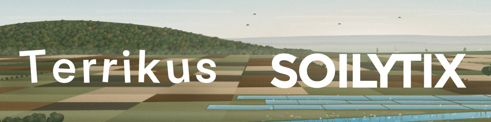

<a href="https://github.com/Soilytix/terrikus/actions/workflows/ci.yml"></a>
<a href="https://github.com/Soilytix/terrikus/actions/workflows/publish.yml"></a>
<a href="https://terrikus.com"></a>


**A playable soil science textbook.** Explore a living river valley across six nested scales and fifteen interactive experiment-driven chapters.

<br>

<a href="https://terrikus.com"></a>

<br>

</div>

---

## Overview

**Terrikus** is an interactive web application designed to teach soil science through active scientific inquiry and exploration. Set within a single representative river valley, players zoom seamlessly across six nested spatial scales:

$$\text{Landscape} \longrightarrow \text{Field} \longrightarrow \text{Profile} \longrightarrow \text{Aggregate and Pore} \longrightarrow \text{Rhizosphere} \longrightarrow \text{Cell}$$

In each chapter, players formulate predictions, conduct controlled experiments, analyze observations, and build causal explanations, recording their discoveries directly into an interactive field notebook.

### Key Pillars

- **Generative Earth-Pigment Aesthetics:** Canvas backdrops are painted live at runtime using seeded procedural brushwork in natural earth pigments, animated by ambient motion (light drift, wind, Brownian movement). Technical overlays, scale indicators, and organism diagrams remain crisp vector drawings.
- **Honest Spatial Scale:** Every view displays an accurate physical scale bar, prominently highlighting _not-to-scale_ indicators whenever elements are magnified for clarity. Scale shifts are automatically stamped in the player's notebook.
- **Mass-Conserving Simulation Engine:** Lab experiments operate under exact double-entry accounting (e.g., _Carbon accounted for: 100.0%_). Bench comparisons isolate single variables, maintaining strict thermodynamic directionality toward heat dissipation.
- **Evidence-Based Explanations:** Hypotheses and cause-effect chains are evaluated in batches as _supported_, _plausible but untested_, or _contradicted by run data_. Recognizing insufficient evidence ("Cannot tell yet; measure X") is treated as a valid scientific conclusion.
- **Differentiated Data Tiers:** The _Scientist Lens_ categorizes interface data into distinct evidence levels: _Measured_ ($\pm$ uncertainty interval), _Derived_ (explicit formula-based calculation), and _Interpreted_ (player confidence level).
- **Fully Sourced & Peer-Reviewed:** Every scientific statement links to a specific source entry in `docs/sources.md` with explicit confidence ratings and transparent peer-review tracking status.
- **Pure Scientific Focus:** Uncompromising pedagogical integrity: free from gamified points, competitive leaderboards, arbitrary soil scores, or commercial product placements.

## Playable Chapters

Chapters 1 and 2 open following the prologue; chapters 3–14 unlock from the valley map as players discover rumors. All chapters reflect ongoing scientific review guided by `docs/world-bible.md`.

<table>
  <tr>
    <td width="280">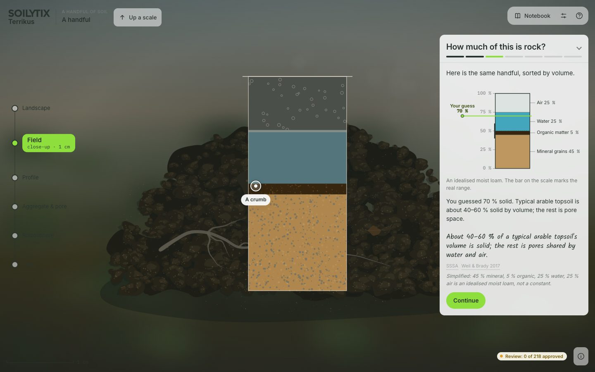</td>
    <td><strong>[P] A Handful of Soil</strong><br><em>Is this alive?</em><br><sub>field → aggregate</sub></td>
  </tr>
  <tr>
    <td width="280">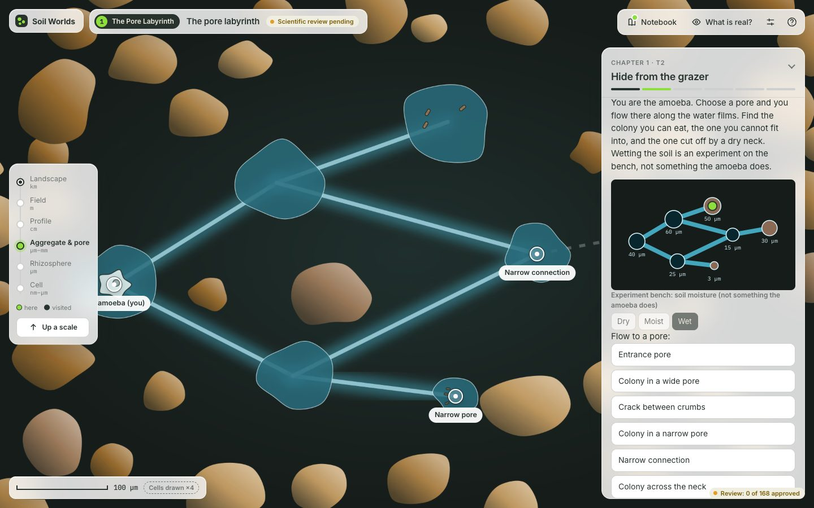</td>
    <td><strong>[1] The Pore Labyrinth</strong><br><em>Why is this bacterium starving next to food?</em><br><sub>aggregate</sub></td>
  </tr>
  <tr>
    <td width="280">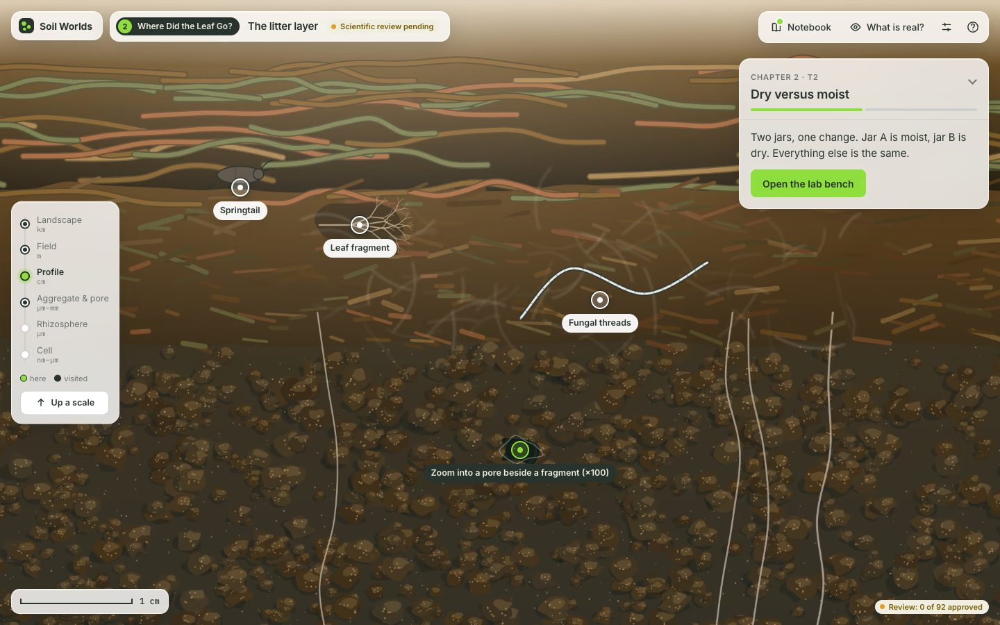</td>
    <td><strong>[2] Where Did the Leaf Go?</strong><br><em>The leaf vanished, but the soil barely got heavier.</em><br><sub>field → profile → aggregate</sub></td>
  </tr>
  <tr>
    <td width="280">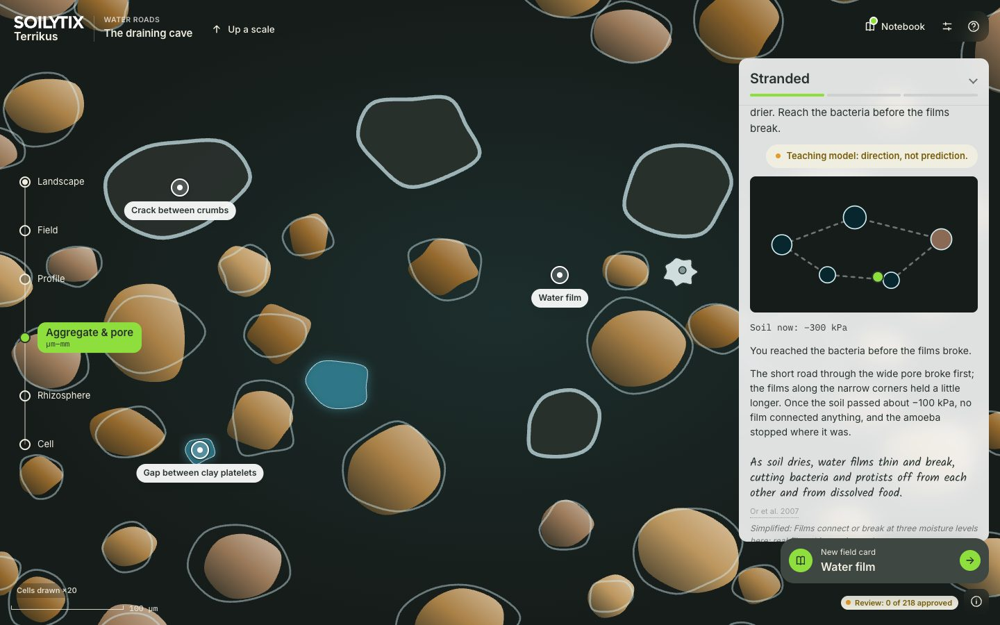</td>
    <td><strong>[3] Water Roads</strong><br><em>After the dry spell, the soil breathed out a burst.</em><br><sub>aggregate, profile</sub></td>
  </tr>
  <tr>
    <td width="280"></td>
    <td><strong>[4] Breath and Rust</strong><br><em>The flooded field smells of eggs, and the rice is fine.</em><br><sub>field, profile</sub></td>
  </tr>
  <tr>
    <td width="280">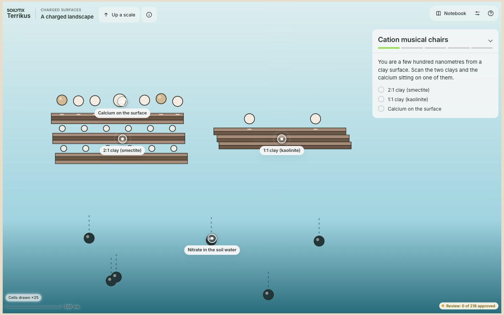</td>
    <td><strong>[5] Charged Surfaces</strong><br><em>The fertiliser stayed exactly where the clay was.</em><br><sub>cell</sub></td>
  </tr>
  <tr>
    <td width="280">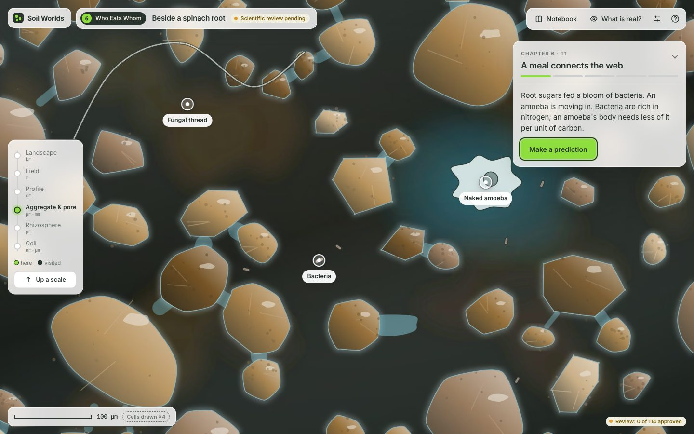</td>
    <td><strong>[6] Who Eats Whom</strong><br><em>Bacteria near the root multiply, then crash.</em><br><sub>aggregate, rhizosphere</sub></td>
  </tr>
  <tr>
    <td width="280">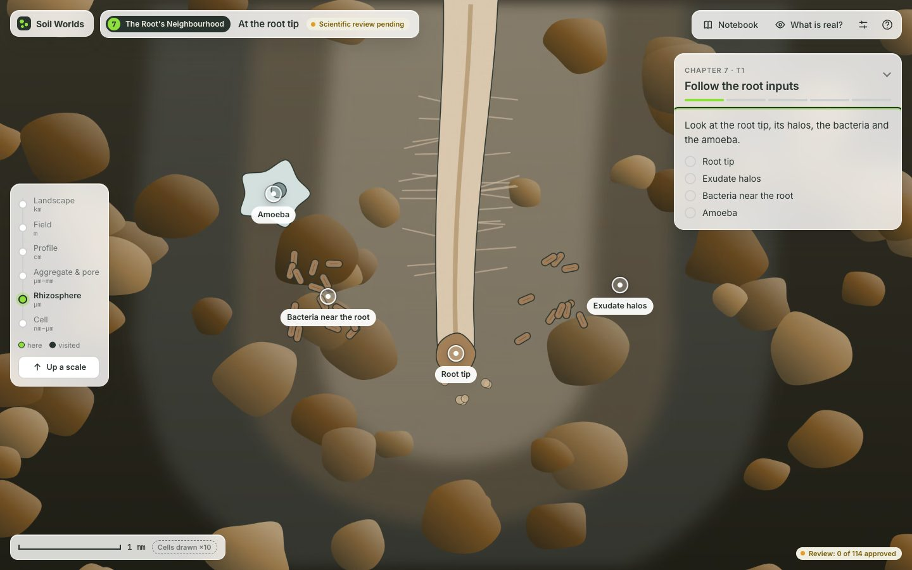</td>
    <td><strong>[7] The Root's Neighbourhood</strong><br><em>The soil touching the root is a different country.</em><br><sub>rhizosphere</sub></td>
  </tr>
  <tr>
    <td width="280"></td>
    <td><strong>[8] Partners and Traders</strong><br><em>One plant grows without nitrogen fertiliser; another forms no partnership with root fungi.</em><br><sub>rhizosphere, cell</sub></td>
  </tr>
  <tr>
    <td width="280">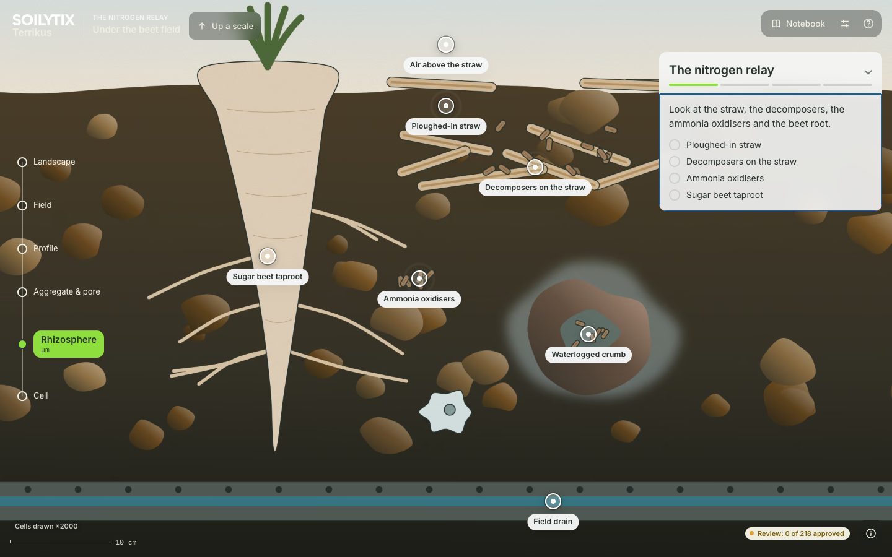</td>
    <td><strong>[9] The Nitrogen Relay</strong><br><em>Straw was ploughed in and the next crop turned yellow.</em><br><sub>rhizosphere</sub></td>
  </tr>
  <tr>
    <td width="280">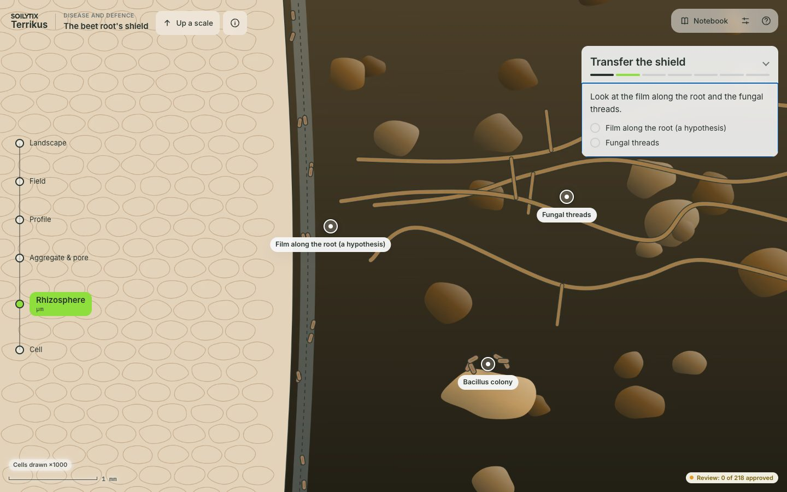</td>
    <td><strong>[10] Disease and Defence</strong><br><em>The pathogen is here, but the plants are healthy.</em><br><sub>rhizosphere</sub></td>
  </tr>
  <tr>
    <td width="280"></td>
    <td><strong>[11] Pit Walls and Deep Time</strong><br><em>Why are these layers different colours?</em><br><sub>profile, landscape</sub></td>
  </tr>
  <tr>
    <td width="280">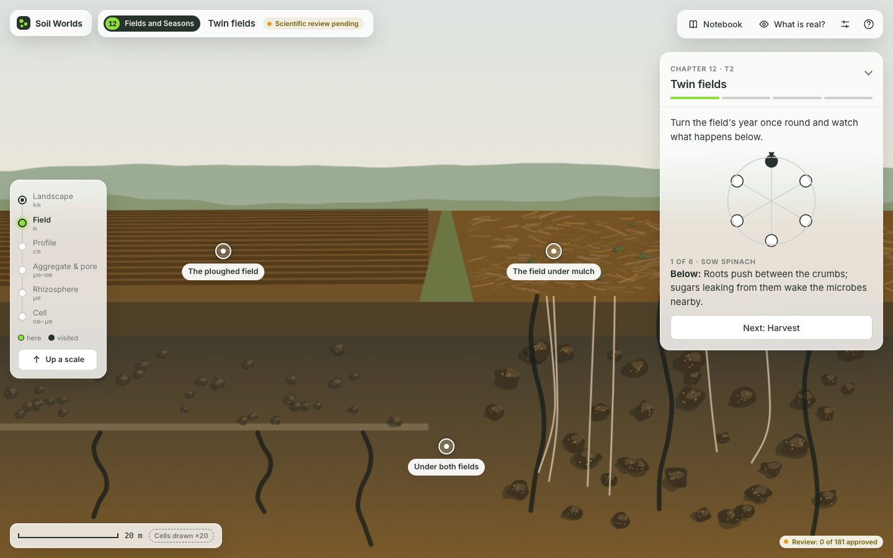</td>
    <td><strong>[12] Fields and Seasons</strong><br><em>Same seed, two fields, different harvests.</em><br><sub>field, aggregate</sub></td>
  </tr>
  <tr>
    <td width="280">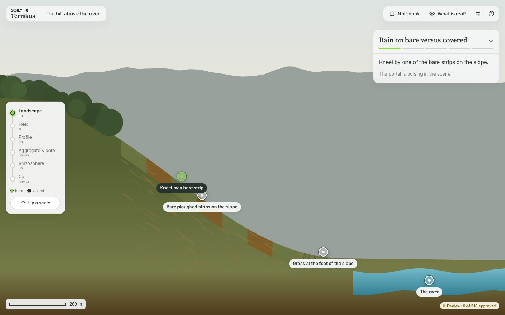</td>
    <td><strong>[13] Hillslope and River</strong><br><em>Where does the soil from the hill go?</em><br><sub>landscape, field</sub></td>
  </tr>
  <tr>
    <td width="280">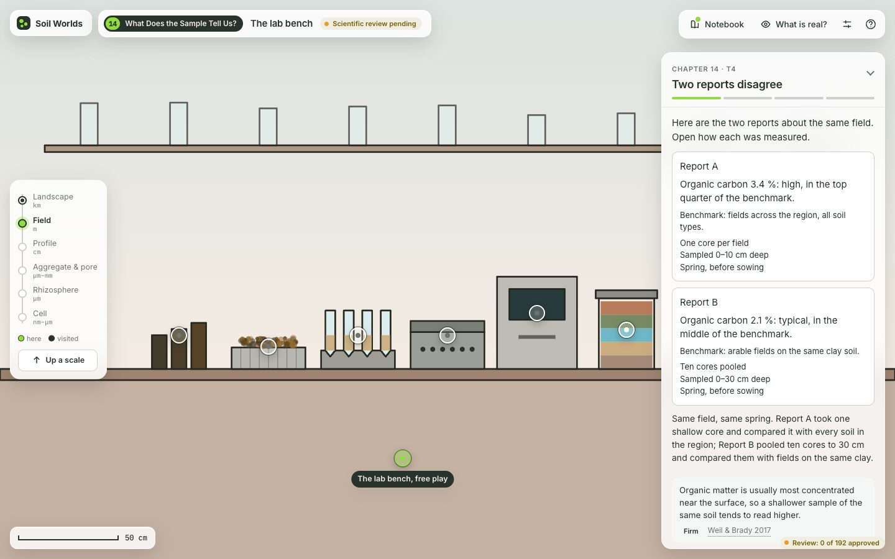</td>
    <td><strong>[14] What Does the Sample Tell Us?</strong><br><em>Two reports about the same field disagree.</em><br><sub>field</sub></td>
  </tr>
</table>

## Controls & Accessibility

| Key                                                 | Function                                          |
| :-------------------------------------------------- | :------------------------------------------------ |
| <kbd>Tab</kbd> / <kbd>Shift</kbd> + <kbd>Tab</kbd>  | Navigate scene elements and interactive portals   |
| <kbd>Enter</kbd> / <kbd>Space</kbd>                 | Inspect target object or traverse selected portal |
| <kbd>+</kbd> / <kbd>−</kbd>                         | Adjust zoom level within active scale             |
| <kbd>←</kbd> <kbd>→</kbd> <kbd>↑</kbd> <kbd>↓</kbd> | Pan scene view                                    |
| <kbd>[</kbd> / <kbd>]</kbd>                         | Select previous / next portal                     |
| <kbd>L</kbd>                                        | Toggle Scientist Lens _(unlocked in Chapter 2)_   |
| <kbd>N</kbd>                                        | Open Field Notebook                               |
| <kbd>?</kbd>                                        | Display context help                              |
| <kbd>Esc</kbd>                                      | Close active modal or navigate up one scale level |

- **Static Fallback:** Appending `?static=1` to the URL renders static painted plates while preserving interactive controls.
- **Reduced Motion:** Fully honors system-level `prefers-reduced-motion` settings and includes an explicit in-app motion toggle in Settings.

## Development & Deployment

### Prerequisites & Setup

Terrikus relies on [mise](https://mise.jdx.dev) for toolchain management.

```sh
git clone git@github.com:Soilytix/terrikus.git
cd terrikus

mise run setup # Install tools, dependencies, setup git hooks, and run initial checks
mise run dev # Start local development server (http://localhost:5173)
mise run check # Run the full verification suite
mise run e2e # End-to-end Playwright visual regression and smoke tests

```
