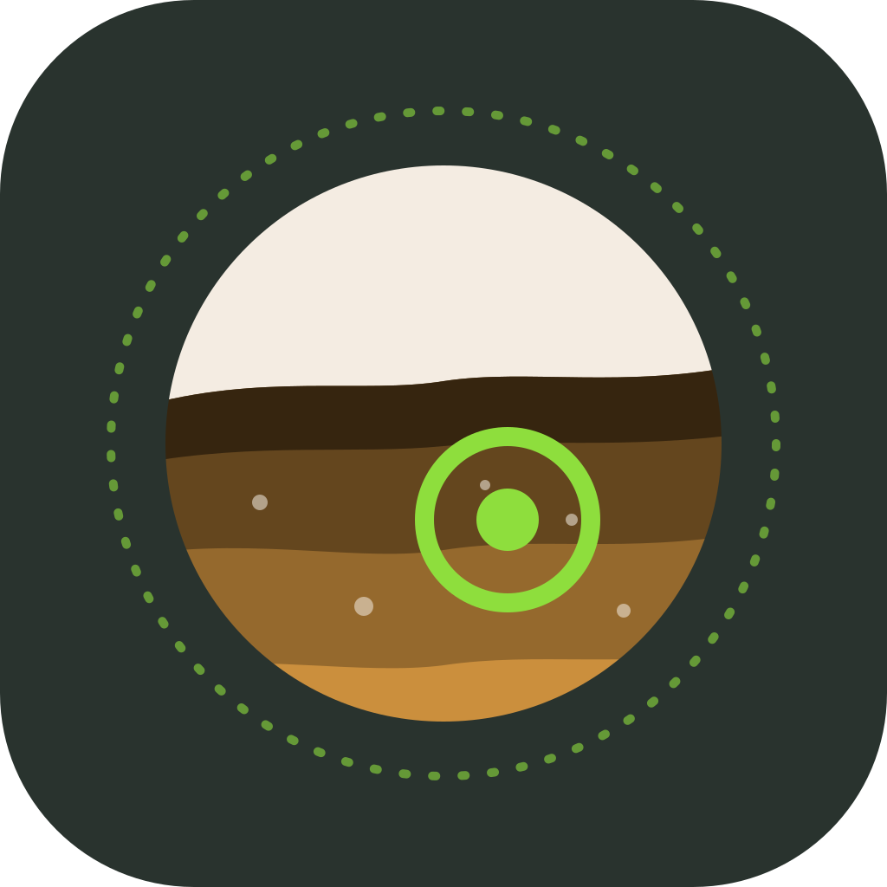
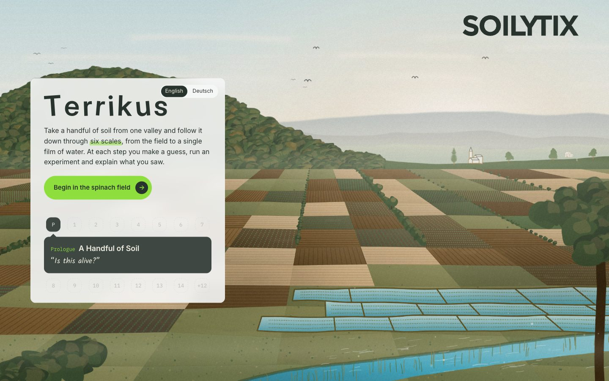
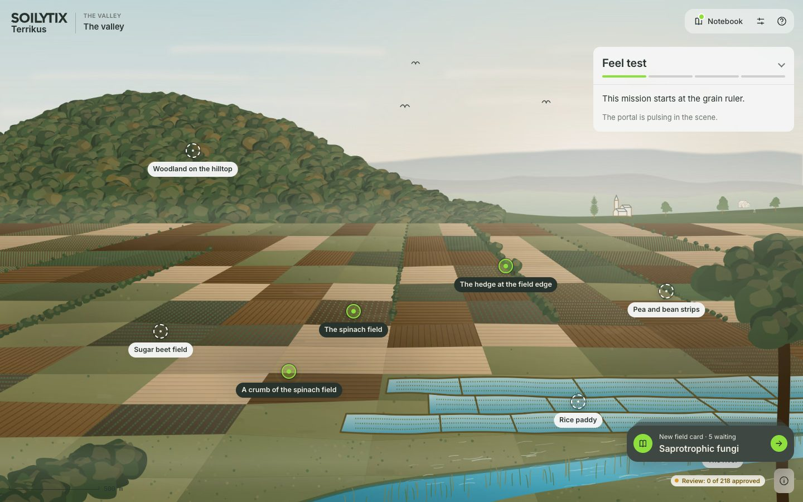
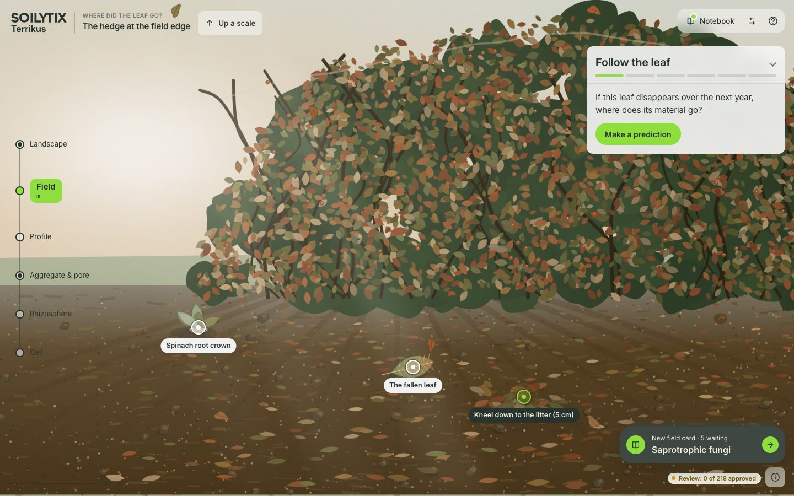
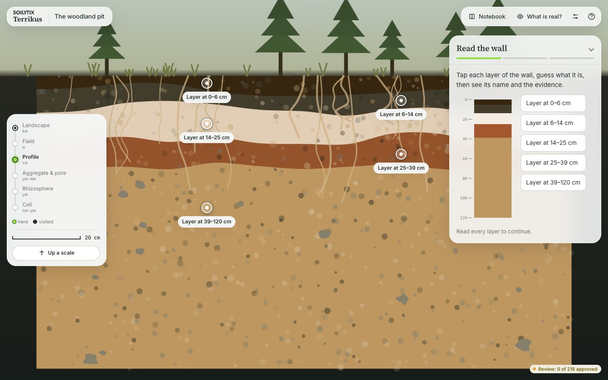
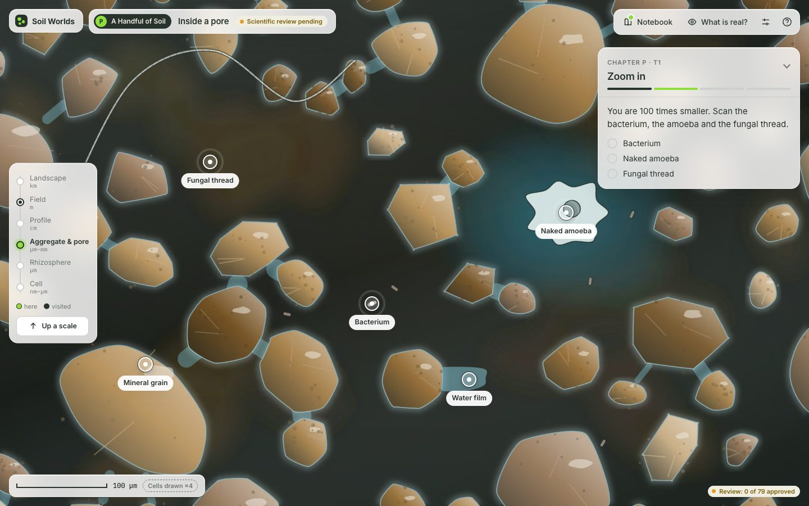
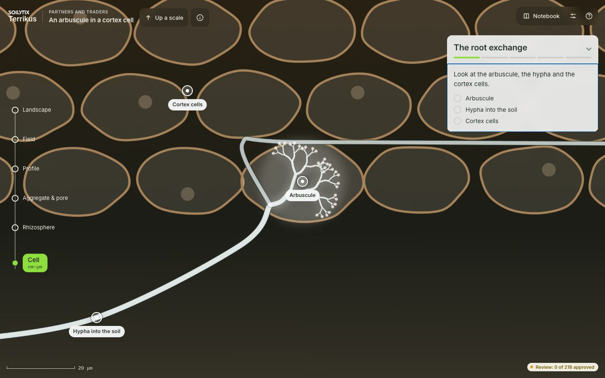
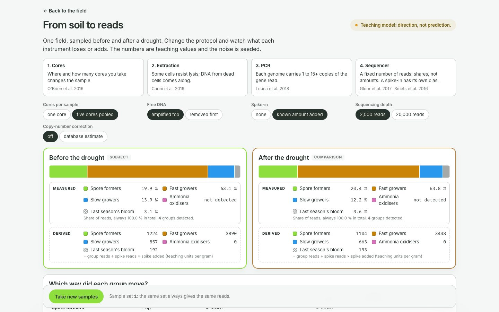
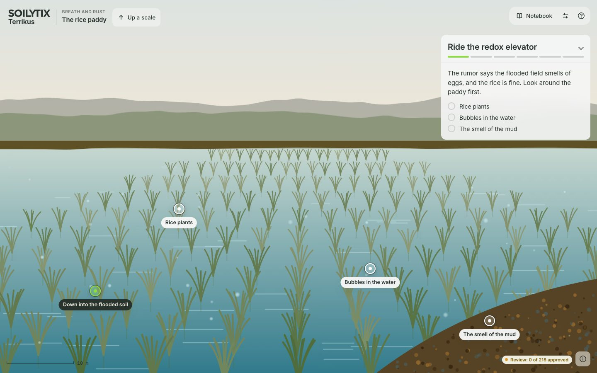
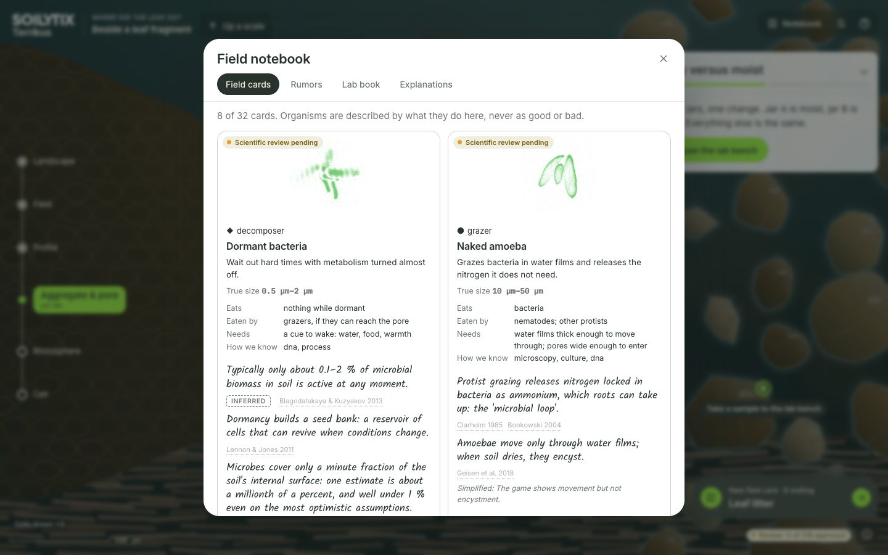

<h3>pedologicus</h3>

<p>
  <sub>A PLAYABLE SOIL SCIENCE TEXTBOOK</sub>
  <br>
  <strong>Explore one valley across six scales and learn soil science by running experiments, for Soilytix colleagues and partners without a soil background.</strong>
  <br>
  <br>
  <a href="https://github.com/Soilytix/soil-worlds/actions/workflows/ci.yml">
    
  </a>
  
  <a href="package.json">
    
  </a>
  
</p>

<br clear="left">

<table>
  <tr>
    <td></td>
    <td></td>
    <td></td>
  </tr>
  <tr>
    <td></td>
    <td></td>
    <td></td>
  </tr>
  <tr>
    <td></td>
    <td></td>
    <td></td>
  </tr>
</table>

<sub>Screens from <code>mise run e2e</code>, refreshed in <code>docs/screens/</code>.</sub>

- [What it does](#what-it-does)
- [Install](#install)
- [Chapters](#chapters)
- [Controls](#controls)
- [Where it runs](#where-it-runs)
- [Configuration](#configuration)
- [Development](#development)

## What it does

Pedologicus is a web app that teaches soil science through exploration. The
player stands in one generic river valley and zooms down a ladder of scales:
landscape, field, profile, aggregate and pore, rhizosphere, cell. Each chapter
is a place with experiments. The player predicts, runs, observes and explains,
and keeps what they learn as their own entries in a field notebook.

- **Painted, living world.** Every backdrop is painted at runtime by a seeded
  brush painter in earth pigments and moves gently (wind, drifting light,
  Brownian shimmer). Knowledge stays crisp: organisms, scale bars and labels
  are drawn, never painted.
- **Honest scale.** Every scene carries a true scale bar and a _not to scale_
  badge when anything is enlarged; crossing a rung stamps the notebook.
- **A mass-conserving teaching simulation.** The leaf-in-a-jar bench runs an
  integer double-entry carbon ledger: "Carbon accounted for: 100.0 %", always.
  Two jars compare one change at a time, and an energy bar only ever grows
  toward heat.
- **Explanations, not scores.** Cause-chain cards are confirmed in a batch and
  answered with _supported_, _plausible but untested_ or _contradicted by your
  run_. "Cannot tell yet; measure X" is a correct answer.
- **Measurement versus inference.** The Scientist lens re-skins readouts into
  measured (± band), derived (formula), interpreted (your confidence) tiers.
- **Sourced and reviewable.** Every fact cites an id from `docs/sources.md` and
  carries a confidence; every node shows its scientific review status.

It never shows a Soilytix product, capability or result, never names a
customer, and has no points, leaderboards or soil-health score.

## Install

Needs [mise](https://mise.jdx.dev). Everything else comes from `mise.toml`.

```sh
git clone git@github.com:Soilytix/soil-worlds.git
cd soil-worlds
mise run setup      # tools, dependencies, git hooks, full check
mise run dev        # http://localhost:5173
```

`mise run build` writes a static site to `dist/` with relative paths, so it
works from any path prefix.

## Chapters

| Chapter                    | Scales                                | Status                                               |
| -------------------------- | ------------------------------------- | ---------------------------------------------------- |
| P · A Handful of Soil      | field → handful → aggregate           | playable, review pending                             |
| 2 · Where Did the Leaf Go? | field → litter → aggregate, lab bench | playable, review pending                             |
| 1, 3–14                    | all                                   | glimpsed in the valley, planned in `docs/backlog.md` |

The content authority is `docs/world-bible.md`; nothing ships that is not
written there first.

## Controls

| Key             | Does                                                     |
| --------------- | -------------------------------------------------------- |
| Tab / Shift-Tab | Move through the scene outline (every object and portal) |
| Enter / Space   | Scan an object or take a portal                          |
| `+` / `−`       | Zoom within the current scale                            |
| Arrow keys      | Pan                                                      |
| `[` / `]`       | Previous / next portal                                   |
| `L`             | Scientist lens (after chapter 2 unlocks it)              |
| `N`             | Field notebook                                           |
| `?`             | Help                                                     |
| Esc             | Close the open panel, or go up one scale                 |

`?static=1` renders every scene as a static painted plate with the same
buttons. The app follows `prefers-reduced-motion`, and Settings has its own
motion switch.

## Where it runs

A static build with no backend and no network calls. Progress is saved in the
browser's `localStorage` under `soilworlds:v1` and can be exported and imported
as JSON from Settings. Every merge to main publishes behind IAP to
`hub.<base_domain>/artifacts/soil-worlds/` (`.github/workflows/publish.yml`; spec
OD-4, founder to review), and publicly to <https://pedologicus.com> as a Cloudflare
Worker (OD-5).

## Configuration

| Variable           | Default    | Consumed by                               |
| ------------------ | ---------- | ----------------------------------------- |
| `SW_PROFILE`       | `internal` | `vite.config.ts`, `tests/profile.test.ts` |
| `SW_DENYLIST_FILE` | unset      | `tools/hash-denylist.ts`                  |

See `.env.example` for what each one means.

## Development

`mise run check` is the definition of done: ESLint, Prettier, TypeScript,
vitest, the build, the bundle scan and the size budget. The gates run on their
own as `mise run lint`, `fmt-check`, `typecheck`, `test` and `build`.
`mise run e2e` runs the Playwright smoke over the build and refreshes the
screenshots in `docs/screens/`.

`AGENTS.md` is the working agreement: content rules, colour registers, layout
and the definition of done.
